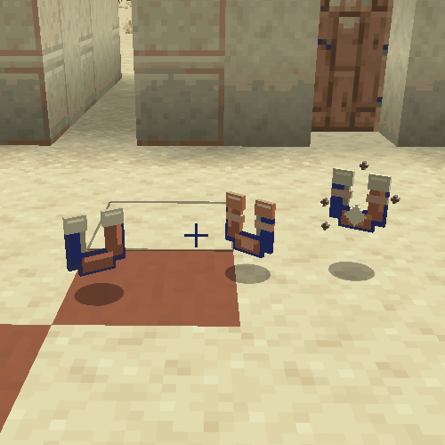
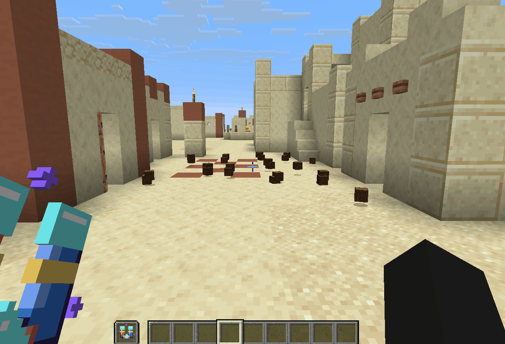

# 🧲 ItemMagnet

**ItemMagnet** is a lightweight Minecraft Fabric mod that lets you attract dropped items and experience orbs from a distance using powerful magnets!

## ✨ Features

- **3 Magnet Tiers:** Weak, Mid and Strong
- **Magnetic Attraction:** Pull nearby dropped items towards you
- **Experience Orbs:** Optionally attract XP orbs
- **Toggle System:** Right-click to enable or disable your magnet
- **Status Effect:** Custom icon displayed while the magnet is active
- **Visual Effects:** Optional particles and sounds
- **Fully Configurable:** Customize settings through Mod Menu or JSON
- **Multilingual:** English and German support

## 🧲 Magnet Tiers

| Magnet | Default Range |
|--------|---------------|
| Weak Magnet | 6 blocks |
| Mid Magnet | 12 blocks |
| Strong Magnet | 20 blocks |

Each tier requires the previous magnet to craft, making progression more rewarding.

## 🎮 How to Use

1. Craft a magnet and hold it in your main hand or offhand.
2. Right-click to activate the magnet.
3. Nearby dropped items will automatically fly towards you.
4. Right-click again to deactivate it.
   

**Note:** Magnets are disabled by default. Their activation state can optionally be saved through the configuration.

## ⚙️ Configuration

Customize the mod using **Mod Menu** or `config/itemmagnet.json`.

Available settings include:
- Magnet range and attraction strength
- Experience orb attraction
- Particles and sound effects
- Magnet activation state persistence
- Custom crafting recipes

## 📦 Requirements

- **Minecraft:** 26.3
- **Mod Loader:** Fabric
- **Fabric API:** Required
- **Java:** 25
- **Mod Menu / Cloth Config:** Recommended for in-game configuration

## 👨‍💻 Author

Developed by **TueftelTyp**

## 📄 License

MIT License
